<!--
EXUCODEX_9X — GitHub Profile README
Logo URLs and HTML attributes are intentionally left unchanged so links and images keep working.
-->

  

<h1 align="center"><b>𝑯𝒆𝒚, 𝑰'𝒎 𝑬𝑿𝑼𝑪𝑶𝑫𝑬𝑿_𝟗𝑿</b></h1>
<h3 align="center"><b>𝑫𝒆𝒗𝒆𝒍𝒐𝒑𝒆𝒓 𝒂𝒏𝒅 𝑨𝒖𝒕𝒐𝒎𝒂𝒕𝒊𝒐𝒏 𝑨𝒅𝒅𝒊𝒄𝒕 𝒇𝒓𝒐𝒎 𝑩𝒂𝒏𝒈𝒍𝒂𝒅𝒆𝒔𝒉</b></h3>

  

  
  
  
   
  
  

---

## 𝑨𝒃𝒐𝒖𝒕 𝑻𝒉𝒊𝒔 𝑷𝒓𝒐𝒋𝒆𝒄𝒕 — `Nm.bot`

**Description:** Built and maintained by exu-coder.

**Language:** JavaScript

**Owner:** exu-coder  
**Visibility:** public  
**License:** None  
**Default Branch:** main

> This project is part of the exu-coder ecosystem. Style, badges and layout match the EXUCODEX_9X profile README for consistency.

---

## 𝑴𝒆

- **𝑲𝒏𝒐𝒘𝒏 𝒂𝒔:** 𝑬𝑿𝑼𝑪𝑶𝑫𝑬𝑿_𝟗𝑿
- **𝑨𝒈𝒆:** 𝟏𝟖
- **𝑳𝒐𝒄𝒂𝒕𝒊𝒐𝒏:** 𝑩𝒂𝒏𝒈𝒍𝒂𝒅𝒆𝒔𝒉
- **𝑳𝒂𝒏𝒈𝒖𝒂𝒈𝒆𝒔:** 𝑩𝒂𝒏𝒈𝒍𝒂, 𝑬𝒏𝒈𝒍𝒊𝒔𝒉
- **𝑷𝒓𝒐𝒈𝒓𝒂𝒎𝒎𝒊𝒏𝒈 𝒊𝒏:** 𝑴𝒂𝒊𝒏𝒍𝒚 𝑷𝒚𝒕𝒉𝒐𝒏
- **𝑯𝒐𝒘 𝒊𝒕 𝒔𝒕𝒂𝒓𝒕𝒆𝒅:** 𝑰'𝒗𝒆 𝒃𝒆𝒆𝒏 𝒑𝒂𝒔𝒔𝒊𝒐𝒏𝒂𝒕𝒆 𝒂𝒃𝒐𝒖𝒕 𝒕𝒆𝒄𝒉𝒏𝒐𝒍𝒐𝒈𝒚 𝒔𝒊𝒏𝒄𝒆 𝑰 𝒘𝒂𝒔 𝒚𝒐𝒖𝒏𝒈, 𝒂𝒏𝒅 𝑰 𝒃𝒆𝒈𝒂𝒏 𝒄𝒐𝒅𝒊𝒏𝒈 𝒂𝒓𝒐𝒖𝒏𝒅 𝒕𝒉𝒆 𝒂𝒈𝒆 𝒐𝒇 𝟏𝟑–𝟏𝟒.
- **𝑭𝒖𝒏 𝒇𝒂𝒄𝒕:** 𝑰 𝒘𝒂𝒏𝒕 𝒕𝒐 𝒔𝒑𝒆𝒂𝒌 𝑹𝒖𝒔𝒔𝒊𝒂𝒏 𝒔𝒐 𝒃𝒂𝒅 𝒍𝒐𝒍.

---

## 𝑨𝒃𝒐𝒖𝒕 𝑴𝒆

- 𝑰 𝒄𝒓𝒆𝒂𝒕𝒆 𝒕𝒐𝒐𝒍𝒔, 𝒃𝒐𝒕𝒔, 𝒂𝒏𝒅 𝒂𝒖𝒕𝒐𝒎𝒂𝒕𝒊𝒐𝒏𝒔 𝒕𝒉𝒂𝒕 *𝒋𝒖𝒔𝒕 𝒘𝒐𝒓𝒌*.
- 𝑪𝒖𝒓𝒓𝒆𝒏𝒕𝒍𝒚 𝒍𝒆𝒂𝒓𝒏𝒊𝒏𝒈 𝑪++.
- 𝑰𝒏𝒕𝒆𝒓𝒆𝒔𝒕𝒆𝒅 𝒊𝒏 𝑫𝒊𝒔𝒄𝒐𝒓𝒅 𝒂𝒏𝒅 𝑻𝒆𝒍𝒆𝒈𝒓𝒂𝒎 𝒃𝒐𝒕𝒔, 𝑨𝑷𝑰𝒔, 𝒄𝒚𝒃𝒆𝒓𝒔𝒆𝒄𝒖𝒓𝒊𝒕𝒚, 𝒇𝒖𝒍𝒍-𝒔𝒕𝒂𝒄𝒌 𝒅𝒆𝒗𝒆𝒍𝒐𝒑𝒎𝒆𝒏𝒕, 𝒉𝒐𝒎𝒆𝒍𝒂𝒃𝒃𝒊𝒏𝒈, 𝒄𝒓𝒚𝒑𝒕𝒐, 𝒈𝒂𝒎𝒆 𝒄𝒉𝒆𝒂𝒕𝒔, 𝒎𝒂𝒍𝒘𝒂𝒓𝒆 𝒂𝒏𝒂𝒍𝒚𝒕𝒊𝒄𝒔, 𝒂𝒏𝒅 𝒃𝒖𝒈 𝒃𝒐𝒖𝒏𝒕𝒚 𝒉𝒖𝒏𝒕𝒊𝒏𝒈.
- 𝑪𝒐𝒎𝒇𝒐𝒓𝒕𝒂𝒃𝒍𝒆 𝒘𝒐𝒓𝒌𝒊𝒏𝒈 𝒊𝒏 𝒃𝒐𝒕𝒉 𝑳𝒊𝒏𝒖𝒙 𝒂𝒏𝒅 𝑾𝒊𝒏𝒅𝒐𝒘𝒔 𝒆𝒏𝒗𝒊𝒓𝒐𝒏𝒎𝒆𝒏𝒕𝒔.

---

## 𝑲𝒏𝒐𝒘𝒍𝒆𝒅𝒈𝒆 𝑨𝒓𝒆𝒂𝒔

- 𝑹𝒆𝒗𝒆𝒓𝒔𝒆 𝑬𝒏𝒈𝒊𝒏𝒆𝒆𝒓𝒊𝒏𝒈 & 𝑴𝒂𝒍𝒘𝒂𝒓𝒆 𝑨𝒏𝒂𝒍𝒚𝒔𝒊𝒔
- 𝑨𝑷𝑰 𝑫𝒆𝒔𝒊𝒈𝒏 & 𝑹𝑬𝑺𝑻𝒇𝒖𝒍 𝑺𝒆𝒓𝒗𝒊𝒄𝒆 𝑰𝒏𝒕𝒆𝒈𝒓𝒂𝒕𝒊𝒐𝒏
- 𝑺𝒆𝒔𝒔𝒊𝒐𝒏 & 𝑷𝒓𝒐𝒄𝒆𝒔𝒔 𝑴𝒂𝒏𝒂𝒈𝒆𝒎𝒆𝒏𝒕
- 𝑨𝒖𝒕𝒐𝒎𝒂𝒕𝒊𝒐𝒏 𝒘𝒊𝒕𝒉 𝑺𝒄𝒉𝒆𝒅𝒖𝒍𝒆𝒓𝒔, 𝑾𝒆𝒃𝒉𝒐𝒐𝒌𝒔 & 𝑩𝒐𝒕𝒔
- 𝑫𝒊𝒔𝒄𝒐𝒓𝒅/𝑻𝒆𝒍𝒆𝒈𝒓𝒂𝒎 𝑩𝒐𝒕 𝑭𝒓𝒂𝒎𝒆𝒘𝒐𝒓𝒌𝒔
- 𝑳𝒊𝒄𝒆𝒏𝒔𝒆 & 𝑲𝒆𝒚-𝑩𝒂𝒔𝒆𝒅 𝑨𝒖𝒕𝒉𝒆𝒏𝒕𝒊𝒄𝒂𝒕𝒊𝒐𝒏 𝑺𝒚𝒔𝒕𝒆𝒎𝒔
- 𝑵𝒆𝒕𝒘𝒐𝒓𝒌 𝑴𝒐𝒏𝒊𝒕𝒐𝒓𝒊𝒏𝒈 & 𝑷𝒓𝒐𝒙𝒚 𝑰𝒏𝒕𝒆𝒓𝒄𝒆𝒑𝒕𝒊𝒐𝒏
- 𝑭𝒖𝒍𝒍-𝑺𝒕𝒂𝒄𝒌 𝑫𝒆𝒗𝒆𝒍𝒐𝒑𝒎𝒆𝒏𝒕 (𝑭𝒓𝒐𝒏𝒕𝒆𝒏𝒅 ↔ 𝑩𝒂𝒄𝒌𝒆𝒏𝒅)
- 𝑪𝑳𝑰 & 𝑮𝑼𝑰 𝑻𝒐𝒐𝒍 𝑫𝒆𝒗𝒆𝒍𝒐𝒑𝒎𝒆𝒏𝒕
- 𝑾𝒊𝒏𝒅𝒐𝒘𝒔 (𝟏𝟎 & 𝟏𝟏) 𝒂𝒏𝒅 𝑳𝒊𝒏𝒖𝒙 (𝒎𝒂𝒊𝒏𝒍𝒚 𝑨𝒓𝒄𝒉, 𝑼𝒃𝒖𝒏𝒕𝒖, 𝑲𝒂𝒍𝒊 & 𝑹𝑬𝑴𝒏𝒖𝒙)
- 𝑽𝒖𝒍𝒏𝒆𝒓𝒂𝒃𝒊𝒍𝒊𝒕𝒚 𝑹𝒆𝒔𝒆𝒂𝒓𝒄𝒉 & 𝑬𝒙𝒑𝒍𝒐𝒊𝒕 𝑫𝒊𝒔𝒄𝒐𝒗𝒆𝒓𝒚

---

## 𝑴𝒊𝒍𝒆𝒔𝒕𝒐𝒏𝒆𝒔

- [x] 𝑮𝒆𝒕 𝒊𝒏𝒕𝒐 𝒅𝒆𝒗𝒆𝒍𝒐𝒑𝒎𝒆𝒏𝒕
- [x] 𝑳𝒆𝒂𝒓𝒏 𝑷𝒚𝒕𝒉𝒐𝒏 𝒅𝒆𝒆𝒑𝒍𝒚
- [x] 𝑼𝒏𝒅𝒆𝒓𝒔𝒕𝒂𝒏𝒅 𝑨𝑷𝑰 𝒅𝒆𝒔𝒊𝒈𝒏 𝒂𝒏𝒅 𝒊𝒏𝒕𝒆𝒈𝒓𝒂𝒕𝒊𝒐𝒏
- [x] 𝑩𝒖𝒊𝒍𝒅 𝒂𝒖𝒕𝒐𝒎𝒂𝒕𝒊𝒐𝒏 𝒕𝒐𝒐𝒍𝒔 𝒂𝒏𝒅 𝒃𝒐𝒕𝒔
- [x] 𝑫𝒊𝒗𝒆 𝒊𝒏𝒕𝒐 𝒇𝒖𝒍𝒍-𝒔𝒕𝒂𝒄𝒌 𝒅𝒆𝒗𝒆𝒍𝒐𝒑𝒎𝒆𝒏𝒕
- [x] 𝑮𝒆𝒕 𝒊𝒏𝒕𝒐 𝒎𝒂𝒍𝒘𝒂𝒓𝒆 𝒂𝒏𝒂𝒍𝒚𝒔𝒊𝒔
- [x] 𝑨𝒅𝒗𝒂𝒏𝒄𝒆 𝒔𝒌𝒊𝒍𝒍𝒔 𝒊𝒏 𝒄𝒚𝒃𝒆𝒓𝒔𝒆𝒄𝒖𝒓𝒊𝒕𝒚
- [x] 𝑯𝒆𝒍𝒑 𝒑𝒆𝒐𝒑𝒍𝒆 𝒑𝒓𝒐𝒕𝒆𝒄𝒕 𝒕𝒉𝒆𝒎𝒔𝒆𝒍𝒗𝒆𝒔 𝒇𝒓𝒐𝒎 𝒄𝒚𝒃𝒆𝒓𝒂𝒕𝒕𝒂𝒄𝒌𝒔
- [x] 𝑹𝒆𝒑𝒐𝒓𝒕 𝒔𝒆𝒓𝒊𝒐𝒖𝒔 𝒗𝒖𝒍𝒏𝒆𝒓𝒂𝒃𝒊𝒍𝒊𝒕𝒊𝒆𝒔 𝒕𝒐 𝒄𝒐𝒎𝒑𝒂𝒏𝒊𝒆𝒔
- [ ] 𝑨𝒅𝒗𝒂𝒏𝒄𝒆 𝒔𝒌𝒊𝒍𝒍𝒔 𝒊𝒏 𝑪++
- [ ] 𝑮𝒓𝒐𝒘 𝒇𝒖𝒓𝒕𝒉𝒆𝒓 𝒊𝒏 𝒘𝒆𝒃 𝒅𝒆𝒗𝒆𝒍𝒐𝒑𝒎𝒆𝒏𝒕

---

## 𝑳𝒂𝒏𝒈𝒖𝒂𝒈𝒆𝒔 & 𝑻𝒐𝒐𝒍𝒔

  
  
  
  
  
  
  
  
  
  
  
  
  
  

---

## 𝑳𝒐𝒈𝒐

  

---

## 𝑪𝒖𝒓𝒓𝒆𝒏𝒕 𝑭𝒐𝒄𝒖𝒔

- 𝑩𝒖𝒊𝒍𝒅𝒊𝒏𝒈 𝒂𝒏𝒅 𝒓𝒆𝒇𝒊𝒏𝒊𝒏𝒈 𝒑𝒂𝒚𝒎𝒆𝒏𝒕 𝒔𝒚𝒔𝒕𝒆𝒎𝒔 𝒘𝒊𝒕𝒉 𝒔𝒆𝒄𝒖𝒓𝒆 𝒉𝒂𝒏𝒅𝒍𝒊𝒏𝒈, 𝒗𝒂𝒍𝒊𝒅𝒂𝒕𝒊𝒐𝒏, 𝒂𝒏𝒅 𝒂𝒖𝒕𝒐𝒎𝒂𝒕𝒊𝒐𝒏.
- 𝑰𝒎𝒑𝒍𝒆𝒎𝒆𝒏𝒕𝒊𝒏𝒈 𝒍𝒊𝒄𝒆𝒏𝒔𝒆-𝒌𝒆𝒚 𝒈𝒆𝒏𝒆𝒓𝒂𝒕𝒊𝒐𝒏 𝒂𝒏𝒅 𝒗𝒆𝒓𝒊𝒇𝒊𝒄𝒂𝒕𝒊𝒐𝒏 𝒘𝒐𝒓𝒌𝒇𝒍𝒐𝒘𝒔.
- 𝑫𝒆𝒗𝒆𝒍𝒐𝒑𝒊𝒏𝒈 𝒂𝒖𝒕𝒐𝒎𝒂𝒕𝒊𝒐𝒏 𝒕𝒐𝒐𝒍𝒔 𝒇𝒐𝒓 𝒅𝒆𝒑𝒍𝒐𝒚𝒎𝒆𝒏𝒕, 𝒔𝒆𝒔𝒔𝒊𝒐𝒏 𝒎𝒂𝒏𝒂𝒈𝒆𝒎𝒆𝒏𝒕, 𝒂𝒏𝒅 𝒔𝒆𝒓𝒗𝒊𝒄𝒆 𝒄𝒐𝒏𝒕𝒓𝒐𝒍.
- 𝑰𝒏𝒕𝒆𝒈𝒓𝒂𝒕𝒊𝒏𝒈 𝒓𝒆𝒂𝒍-𝒕𝒊𝒎𝒆 𝒎𝒐𝒏𝒊𝒕𝒐𝒓𝒊𝒏𝒈 𝒂𝒏𝒅 𝒓𝒆𝒑𝒐𝒓𝒕𝒊𝒏𝒈 𝒇𝒐𝒓 𝒕𝒓𝒂𝒏𝒔𝒂𝒄𝒕𝒊𝒐𝒏𝒔, 𝒔𝒚𝒔𝒕𝒆𝒎 𝒉𝒆𝒂𝒍𝒕𝒉, 𝒂𝒏𝒅 𝒍𝒊𝒄𝒆𝒏𝒔𝒆 𝒔𝒕𝒂𝒕𝒖𝒔.
- 𝑼𝒑𝒍𝒐𝒂𝒅𝒊𝒏𝒈 𝒂𝒏𝒅 𝒓𝒆𝒗𝒂𝒎𝒑𝒊𝒏𝒈 𝒐𝒍𝒅 𝒑𝒓𝒐𝒋𝒆𝒄𝒕𝒔 𝒐𝒏 𝑮𝒊𝒕𝑯𝒖𝒃.

---

## 𝑾𝒂𝒏𝒏𝒂 𝑪𝒉𝒂𝒕?

  
  
  
  

<i>“𝑺𝒆𝒆 𝒕𝒉𝒆 𝑵𝒆𝒕𝒘𝒐𝒓𝒌 𝒘𝒊𝒕𝒉 𝑶𝒕𝒉𝒆𝒓 𝑷𝒆𝒓𝒔𝒑𝒆𝒄𝒕𝒊𝒗𝒆𝒔.”</i>

  

  

---

## 𝑷𝒓𝒐𝒇𝒊𝒍𝒆 𝑴𝒂𝒑 — 𝑴𝒆𝒓𝒎𝒂𝒊𝒅 𝑫𝒊𝒂𝒈𝒓𝒂𝒎

```mermaid
flowchart TD
    A["EXUCODEX_9X<br/>Developer & Automation"] --> B["Me"]
    A --> C["About Me"]
    A --> D["Knowledge Areas"]
    A --> E["Milestones"]
    A --> F["Languages & Tools"]
    A --> G["Current Focus"]
    A --> H["Wanna Chat?"]

    B --> B1["Bangladesh · Bangla & English"]
    C --> C1["Tools · Bots · Automation"]
    C --> C2["Cybersecurity · Full-stack"]
    D --> D1["Reverse Engineering"]
    D --> D2["APIs · Networking · Development"]
    E --> E1["Python · APIs · Bots"]
    E --> E2["Learning C++ · Web Development"]
    F --> F1["Python · Git · Docker"]
    F --> F2["Linux · Windows · Security Tools"]
    G --> G1["Payment & License Systems"]
    G --> G2["Automation & Monitoring"]
    H --> H1["Telegram · Facebook · Instagram · Email"]

    classDef main fill:#071a2f,stroke:#1687ff,color:#ffffff,stroke-width:2px;
    classDef section fill:#102b46,stroke:#1687ff,color:#ffffff;
    class A main;
    class B,C,D,E,F,G,H,B1,C1,C2,D1,D2,E1,E2,F1,F2,G1,G2,H1 section;
```

  

